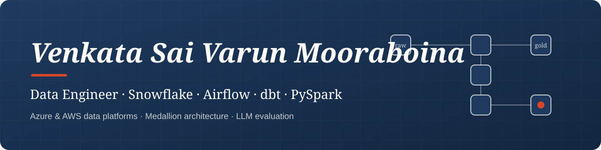
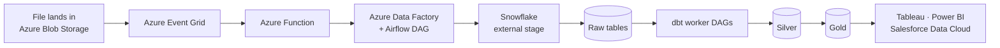

**4+ years building cloud data platforms, real-time pipelines and analytics layers for healthcare, life insurance and financial services.**
Currently at **CFA Institute** (Charlottesville, VA), open to Data Engineering roles.

---

## 📊 Impact at a glance

| 4+ yrs | 10+ sources | 1,085 columns | -30% | -60% | +47% |
|:---:|:---:|:---:|:---:|:---:|:---:|
| data engineering | SaaS feeds owned into Snowflake | clickstream ingested event-driven | ingestion time (Glue/PySpark/EMR) | reporting latency (Customer 360) | query speed (Snowflake migration) |

**Open to:** Data Engineer · Analytics Engineer · Data Platform roles (Snowflake, Airflow, dbt, Azure/AWS)

## 👋 About

I turn scattered, messy source data into clean, documented datasets that analysts and models can trust. My day job is end-to-end ingestion into **Snowflake** with **Airflow**, **dbt** and Azure event-driven services. Before that I built AWS and Databricks pipelines at **Molina Healthcare** and **Syscon Solutions**. I also lead **LLM evaluation** work and build AI-assisted automation for data engineering tasks.

## 🧱 What I do

| | |
|---|---|
| **Ingest** | 10+ marketing and web-analytics SaaS sources into Snowflake via Airflow DAGs with custom Python operators |
| **Model** | Medallion architecture (Bronze → Silver → Gold) with dbt, quality checks and cleaning rules |
| **Serve** | Curated datasets for Salesforce Data Cloud, Tableau and Power BI |
| **Operate** | Pipeline monitoring, failure triage, SLA protection, runbooks and data catalogs |
| **Automate** | AI-assisted pipeline generation, data quality checks and documentation |

## 🏗️ Featured: event-driven clickstream ingestion

A pattern I engineered at CFA Institute for Adobe Analytics data (1,085 columns of hit, visit and session metrics):

More detail in [Architecture notes](wiki/Architecture-Notes.md).

## 💼 Experience

| Role | Where | When | Highlights |
|---|---|---|---|
| Data Engineer & Enterprise Analytics | **CFA Institute** | Mar 2025 – Present | Marketing data SME, Snowflake + Airflow + dbt, Azure event-driven ingestion, LLM evaluation and model-routing standards |
| Data Engineer | **Molina Healthcare** | Jan 2023 – Mar 2025 | AWS ingestion (S3, Glue, Kinesis, Lambda, EMR, Redshift), Databricks/PySpark, Snowflake to Power BI, APIs over RDS and DynamoDB |
| Data Engineer | **Syscon Solutions** | May 2021 – Jun 2022 | Kinesis streaming, Glue/PySpark/EMR pipelines (**-30% ingestion time**), GDPR and PII-aware practices |

Full detail: [Experience](wiki/Experience.md)

## 🛠️ Tech stack

Full breakdown: [Skills & certifications](wiki/Skills-and-Certifications.md)

## 📦 Selected projects

| Project | What it shows | Result |
|---|---|---|
| **Customer 360 Data Platform** | Batch + streaming on S3, Glue, Redshift unifying CRM, product and billing data | **-60%** reporting latency |
| **Data Migration to Snowflake** | PySpark + Databricks migration | **+47%** query speed |
| **Marketing Analytics Dashboard** | Snowflake + dbt models behind Tableau and Power BI | **+40%** campaign visibility |
| **AWS Real-Time Streaming Pipeline** | Kinesis, EMR, PySpark ingestion | Streaming ingestion design |
| [**Spark_V2**](https://github.com/SaiVarun1125/Spark_V2) | Scala + Spark practice projects | Public code |
| [**Room_Marketplace**](https://github.com/SaiVarun1125/Room_Marketplace) | Next.js + Postgres marketplace for individual rooms | Full-stack app |
| [**ML Coursework Portfolio**](https://saivarun1125.github.io/) | Indiana Wesleyan University, AIML-500: AI timeline deck, interview-prep chatbot, ML vs DL report, AI training interaction | Live site |

More: [Projects](wiki/Projects.md)

## 🎓 Education & certifications

- B.S. Computer Science, **University of Central Missouri**
- AWS Associate Data Engineer
- Microsoft Certified: Azure Data Engineer Associate
- Oracle Cloud Infrastructure Certified Foundations Associate
- Data Engineering with dbt · Apache Airflow for Data Engineers
- Currently studying machine learning at Indiana Wesleyan University

## 📫 Let's talk

Hiring for data engineering, analytics engineering or platform roles? Message me on [LinkedIn](https://www.linkedin.com/in/venkata-sai-varun-mooraboina-9568b1238), email **saivarun1125@gmail.com**, or see my [ML coursework portfolio](https://saivarun1125.github.io/).
