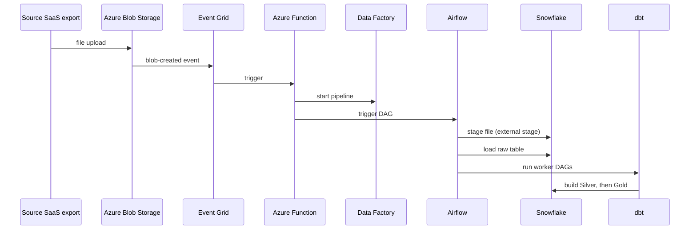

# Architecture Notes

How I approach data platforms, drawn from production work.

## 1. Event-driven ingestion (Azure → Snowflake)

**Why event-driven:** data is processed when it arrives instead of on a fixed schedule, so freshness improves and idle polling is avoided.

## 2. Medallion layers

| Layer | Purpose | Owner tool |
|---|---|---|
| Raw / Bronze | Immutable landing of source data | Airflow, Snowflake COPY |
| Silver | Cleaned, typed, deduplicated | dbt |
| Gold | Business-ready marts for BI and activation | dbt |

## 3. Data quality and operations

- Checks and cleaning rules live in Airflow and dbt, close to the data.
- Failures are triaged across Airflow, Azure Functions and dbt runs, ticketed, and tracked against SLAs.
- Every source is documented in an ingestion/extraction catalog: source, ingestion type, target schema, SLA, cadence, consumers, access roles.

## 4. Governance

GDPR- and PII-aware practices: masking, role-based access, auditability.

## 5. AI in the data workflow

- **LLM evaluation:** compare models across reasoning, coding and routine tasks; route each task type to the right model to control cost within regulatory limits.
- **AI-assisted automation:** pipeline scaffolding, data quality checks and documentation generation.
